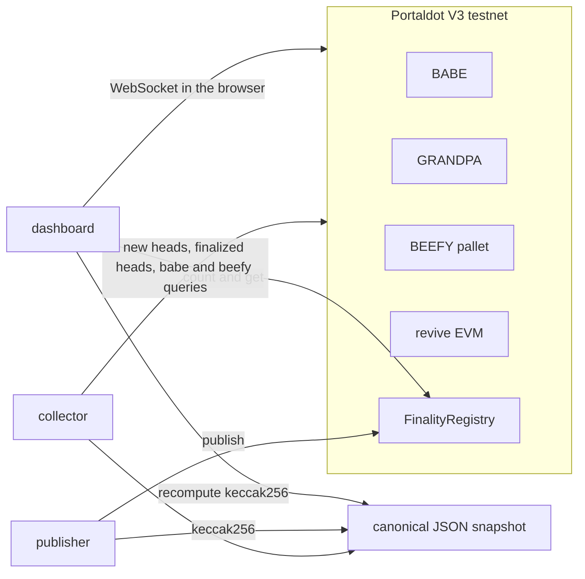

# Portaldot finality monitor

A finality and block-production monitor for the Portaldot V3 testnet. It reads BABE, GRANDPA, and BEEFY from the native node, and it can publish a keccak256 commitment of that snapshot to an EVM attestation contract.

This is a Portaldot Hacker House 2026 entry for the Node Operations & Tooling track.

The contract stores numbers a reporter submits. It does not check BEEFY signatures or GRANDPA justifications. Signature verification is the roadmap toward a light-client bridge. It is not implemented.

## Architecture



The collector subscribes to new heads and finalized heads. For each head it decodes the BABE pre-runtime digest (`SpConsensusBabeDigestsPreDigest`) and maps `authorityIndex` through `session.validators`. `header.author` is empty on this runtime. It also reads `babe.currentSlot`, `beefy.getFinalizedHead`, `beefy.validatorSetId`, and `beefy.authorities`. GRANDPA lag is best minus GRANDPA-finalized. BEEFY lag is GRANDPA-finalized minus BEEFY-finalized.

The publisher hashes the canonical JSON with keccak256, calls `FinalityRegistry.publish`, and writes `snapshots/<hash>.json`. The hash is the UTF-8 of that canonical JSON: object keys sorted, no extra whitespace. A trailing newline is not part of the hash.

## Network

Values below were read from the public endpoints on 23 October 2026. They are observations from those endpoints, not an independent genesis pin.

| | |
|---|---|
| Chain | PortaldotV3 Test |
| Spec | portaldot-v3, spec version 3002 |
| Native WebSocket | `wss://test-node-v3.portaldot.dev` |
| EVM HTTP | `https://test-evm-rpc-v3.portaldot.dev` |
| EVM chain id | 420420777 |
| Reported genesis | `0xd4f9acbcf7f52388d8b095abe3c198d19fc510e0343e643e87cfbccb155283bd` |
| SS58 prefix | 42 |
| Token | `system_properties` reports symbol `tPOT` and 14 decimals. The testnet guide also uses the label `tPOTv3`. |
| Node console | https://node-console.portaldot.dev/ |
| Block scanner | `https://scanner-testnet-v3.portaldot.dev/blocks/<number>` |

`Revive.NativeToEthRatio` was `10000`. `Revive.ChainId` was `420420777`. Existential deposit was `10000000000000` raw units (0.1 token at 14 decimals). `Revive.DepositPerByte` was `6000000000000` raw units.

## Funding and deployment status

An EVM key does not receive testnet tokens directly. The documented path is: take the H160, call `reviveApi.accountId`, and transfer test POT to the returned SS58 account. On this runtime that call returned the fallback account `H160 || 0xEE * 12`.

The throwaway deployer for this repo:

| | |
|---|---|
| EVM address | `0xBF8CbDb1F3c95140EDD688C242843237114C4Ce9` |
| `reviveApi.accountId` | `0xbf8cbdb1f3c95140edd688c242843237114c4ce9eeeeeeeeeeeeeeeeeeeeeeee` |
| SS58 to fund | `5GPrp3eRwH9QzgPCowJKsRzwY1sZPrUF89LvKsbS2uhnkU8x` |

Send test POT to the SS58 address, not to the `0x` address. The private key stays in `.env`, which is gitignored.

On 23 October 2026 both the native free balance and `eth_getBalance` were 0. `eth_estimateGas` for deploying `FinalityRegistry` succeeded and returned `5459314494956310` gas. At the reported gas price of `33280`, that estimate is `181.6859863921459968` EVM-side tokens (`181685986392145996800` wei). The deploy script stopped before submitting a transaction:

```text
deploy: balance 0 wei is below estimated fee 181685986392145996800 wei
```

There is no contract address and no deployment transaction hash until that account is funded and `pnpm deploy` is run again. `pnpm publish` is the same situation: it will not send a transaction without `REGISTRY_ADDRESS` and a balance.

## Run

```bash
pnpm install
git submodule update --init --recursive
cp .env.example .env
# put a throwaway PRIVATE_KEY in .env, then:
pnpm map-account
pnpm collector
pnpm test
forge test
pnpm dev
```

`pnpm collector` follows four new heads by default and writes `evidence/collector-run.jsonl` plus `snapshots/latest.json`. The capture from this session is `evidence/collector-2026-10-23.jsonl`.

After the mapped account has funds:

```bash
pnpm deploy
# copy the address into REGISTRY_ADDRESS in .env
pnpm publish
```

The dashboard reads the node in the browser. Paste a registry address to load `count`, `get`, and `beefyLag`. The hash box canonicalizes pasted JSON, or hashes the exact textarea bytes. Use canonical mode for a snapshot object. Use exact mode for an archived `snapshots/<hash>.json` file with no added newline.

Alert thresholds default to GRANDPA lag 6 and BEEFY lag 24. Those are product settings. During the 23 October sample, GRANDPA lag stayed at 1 and BEEFY lag moved through 7, 0, 1, and 2, so neither threshold fired. A slot gap alert fires when two delivered heads are more than one BABE slot apart.

`babe.lifetimeSlotGap` in a snapshot is `(currentSlot - genesisSlot) - bestNumber`. At capture it was `864`. `babe.skippedEpochs` was an empty list. `skippedSlotsObserved` counts gaps between heads this process actually delivered. A missed websocket message looks like a skip. The four-head sample had no gap (`skippedSlotsObserved` 0).

## What was run on 23 October 2026

- `eth_chainId` returned `0x190f1ca9` (420420777). `eth_getBlockByNumber` returned a block with `baseFeePerGas`.
- `beefy_getFinalizedHead`, `babe.currentSlot`, `babe.genesisSlot`, `beefy.validatorSetId`, `beefy.authorities`, `beefy.genesisBlock`, and `session.validators` all returned values.
- `header.author` was null on four subscribed heads. The BABE authority index and `api.derive.chain.getHeader` named the same validator on all four:
  - index 0, `5F4ZyJJ8R3QHZKRLAfDXdUuVE4w3Q7uq7tCNfAtvf2XEBfYY`, 2 blocks
  - index 1, `5Grj5uKAoduL2EDfgizp2MMbURJKa4rL6Q5pGUnVhhhjhwjk`, 2 blocks
- Every predigest in that sample was `SecondaryPlain`. BEEFY set id was 272, with 2 authority ids.
- Heads in the sample: best 162817–162820. At the end of the run, best was 162820, GRANDPA 162819, BEEFY 162817.
- `forge test` passed 6 tests against `FinalityRegistry` with solc 0.8.19, optimizer runs 200, EVM version paris. The opcode listing contains no `PUSH0`. Creation bytecode is 2152 bytes and the runtime is 2024 bytes. The raw hex still contains the byte `0x5f` inside metadata or data, which is not a `PUSH0` instruction.
- `node --test` covers canonical hashing, lag math, alert thresholds, and slot-gap accounting.
- `pnpm build` produced the dashboard bundle. Headless Chrome loaded that bundle against the preview server. The page connected to `PortaldotV3 Test` and rendered live best, GRANDPA, and BEEFY numbers, both session validators, and the empty-registry message.

## What was not run

- No contract deployment and no `publish` transaction. The deployer balance is 0. See the estimate and the exact error above.
- No on-chain BEEFY signature check. The contract cannot tell a forged snapshot from a real one.
- The slot-gap counter did not observe a real skipped slot in the four-head sample. The unit test covers a synthetic gap of 3.
- A previously deployed contract's runtime code on this endpoint contains the byte sequence `5f 35 60 e0 1c`, which is the usual `PUSH0` dispatcher. That is evidence the endpoint stored bytecode produced by a newer compiler. It is not a test that this project's paris bytecode executes on the network. This project stays on solc 0.8.19.
- The scanner route `/blocks/<number>` is what the scanner's own JavaScript builds. `/tx/<hash>` was not confirmed against a revive receipt, because this project has not sent one.

## Contract

`FinalityRegistry` keeps an append-only list. The deployer is the owner and the first reporter. `setReporter` is owner-only. `publish` is reporter-only. `count`, `get`, and `beefyLag` are public reads. `beefyAuthorities` is the authority count, not the key list. The key list is in the JSON whose hash is stored. `beefyLag` is GRANDPA-finalized minus BEEFY-finalized, or 0 if the stored BEEFY number is ahead.

## Dependencies

The chain is Portaldot. The native node speaks Substrate JSON-RPC, so the collector and the dashboard use the Substrate JavaScript client. Those packages are published under the `@polkadot` npm scope. That scope is the library name. The endpoint, chain id, and runtime this repo talks to are Portaldot V3 testnet.

Runtime:

- `@polkadot/api` 16.4.9, Substrate client for the Portaldot node WebSocket
- `@polkadot/util` 13.5.9
- `@polkadot/util-crypto` 13.5.9, SS58 encoding with prefix 42
- `ethers` 6.15.0, Portaldot revive EVM

Development:

- `vite` 6.4.1
- Foundry `forge-std` v1.17.0, for `forge test` only
- solc 0.8.19+commit.7dd6d404

No OpenZeppelin. The contract does not import another Solidity package.

On connect, the Substrate client prints a warning that the signed extensions `AuthorizeCall` and `EthSetOrigin` are unknown and treated as no-effect. This program does not submit native extrinsics. Writes go through the Portaldot EVM RPC.

## Difference from PortalNode

PortalNode is about reward claims and liveness alerts. This project is about BABE authorship, GRANDPA lag, and BEEFY lag, with an off-chain snapshot a visitor can hash and compare to the registry.
