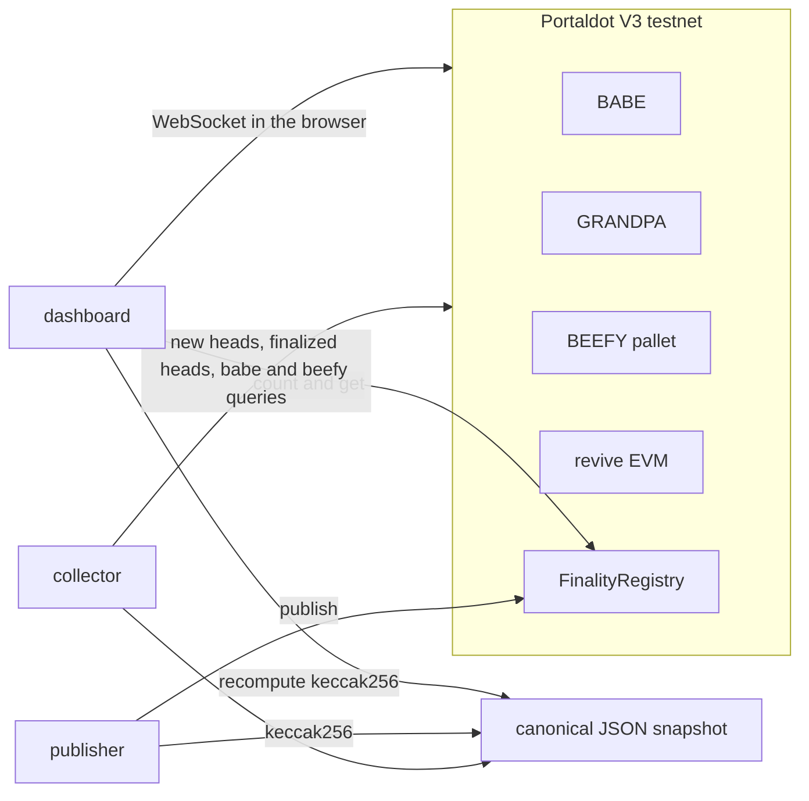

# RIFT — Onchain Intelligence

A configurable Portaldot V3 monitoring dashboard. It includes a Substrate consensus profile for GRANDPA/BEEFY finality and a separate EVM JSON-RPC profile for the same network.

The default monitoring profile is Portaldot V3 Test.

This is a Portaldot Hacker House 2026 entry for the Node Operations & Tooling track.

Source repository: [RIFT source repository](https://github.com/0xNana/RIFT).

The contract stores numbers a reporter submits. It does not check BEEFY signatures or GRANDPA justifications. Signature verification is the roadmap toward a light-client bridge. It is not implemented.

## Product and target user

RIFT helps node and validator-program operators see whether block production, GRANDPA finality, and BEEFY checkpoints are keeping pace. The initial user is a Portaldot operator who needs to identify which stage is lagging and inspect what the monitor observed. This user hypothesis is still to be validated with Portaldot's operations team.

The browser dashboard is implemented in React with Vite. `web/profiles.js` describes each profile's identity, metric cards, chart series, and thresholds. Profile-specific adapters live in `web/monitor-polkadot.js` and `web/monitor-evm.js`; the shared dashboard renders their common metrics, activity filters, source health, and history. Add a profile by defining its UI metadata and providing an adapter that emits the monitor state shape used by those components.

The Portaldot EVM profile reads `eth_blockNumber`, `eth_syncing`, `eth_getBlockByNumber("finalized")`, and optionally `net_peerCount`. Vite reads `EVM_RPC` and `CHAIN_ID` at startup and bundles those public values into the dashboard. Use an endpoint that allows browser CORS and contains no credentials or query-string tokens. The adapter verifies the endpoint reports the configured Portaldot chain id.

The Substrate profile is a network-level consensus monitor, not host telemetry: it does not report CPU, disk, or process health. The collector can be pointed at another endpoint for the same Portaldot V3 testnet with `SUBSTRATE_WS`. The browser profile uses `VITE_SUBSTRATE_WS` at build time and checks chain name, runtime spec, and the observed genesis hash before displaying data. The EVM profile can report peer count only when its RPC endpoint exposes `net_peerCount`.

The registry anchors a reporter-submitted snapshot hash. The dashboard recomputes the hash from the exact archived bytes and compares six archived values (best, GRANDPA, BEEFY, BEEFY set ID, authority count, and observed skipped slots) with the fields stored in the on-chain report. This checks report/archive consistency; neither the hash nor the field comparison proves that the RPC observation reflects consensus truth.

The Substrate overview shows the best → GRANDPA → BEEFY heights, calculated lag, and configured thresholds. Slot gaps are observations between delivered BABE headers because a missed WebSocket notification can look like a skipped slot. The Reports view lets an operator inspect the archived payload against its on-chain hash and stored fields.

See [the Hacker House submission pack](docs/hackathon-submission.md) for the pitch, demo flow, mentor questions, and final handoff checklist.

RIFT's six-slide submission pitch is available as a [PDF](submission/portaldot-finality-submission.pdf).

## Architecture



The collector subscribes to new heads and finalized heads. For each head it decodes the BABE pre-runtime digest (`SpConsensusBabeDigestsPreDigest`) and maps `authorityIndex` through `session.validators`. `header.author` is empty on this runtime. It also reads `babe.currentSlot`, `beefy.getFinalizedHead`, `beefy.validatorSetId`, and `beefy.authorities`. GRANDPA lag is best minus GRANDPA-finalized. BEEFY lag is GRANDPA-finalized minus BEEFY-finalized.

The publisher hashes the canonical JSON with keccak256, calls `FinalityRegistry.publish`, and writes `snapshots/<hash>.json`. The hash is the UTF-8 of that canonical JSON: object keys sorted, no extra whitespace. A trailing newline is not part of the hash.

## Network

Values below were read from the public endpoints on 23 October 2026. They are observations from those endpoints, not an independent genesis pin.

| | |
|---|---|
| Chain | PortaldotV3 Test |
| Spec | portaldot-v3, spec version 3002 |
| Native WebSocket | `wss://test-node-v3.portaldot.dev` |
| EVM HTTP | `https://test-evm-rpc-v3.portaldot.dev` |
| EVM chain id | 420420777 |
| Reported genesis | `0xd4f9acbcf7f52388d8b095abe3c198d19fc510e0343e643e87cfbccb155283bd` |
| SS58 prefix | 42 |
| Token | `system_properties` reports symbol `tPOT` and 14 decimals. The testnet guide also uses the label `tPOTv3`. |
| Node console | https://node-console.portaldot.dev/ |
| Block scanner | `https://scanner-testnet-v3.portaldot.dev/blocks/<number>` |

`Revive.NativeToEthRatio` was `10000`. `Revive.ChainId` was `420420777`. Existential deposit was `10000000000000` raw units (0.1 token at 14 decimals). `Revive.DepositPerByte` was `6000000000000` raw units.

## Funding and deployment status

An EVM key does not receive testnet tokens directly. The documented path is: take the H160, call `reviveApi.accountId`, and transfer test POT to the returned SS58 account. On this runtime that call returned the fallback account `H160 || 0xEE * 12`.

The throwaway deployer for this repo:

| | |
|---|---|
| EVM address | `0xBF8CbDb1F3c95140EDD688C242843237114C4Ce9` |
| `reviveApi.accountId` | `0xbf8cbdb1f3c95140edd688c242843237114c4ce9eeeeeeeeeeeeeeeeeeeeeeee` |
| SS58 to fund | `5GPrp3eRwH9QzgPCowJKsRzwY1sZPrUF89LvKsbS2uhnkU8x` |

Send test POT to the SS58 address, not to the `0x` address. The private key stays in `.env`, which is gitignored.

On 24 October 2026 the mapped account held 210 tPOT native and 209.9 on the EVM side. Deployment was included in block 173034 with status 1.

| | |
|---|---|
| Contract | `0x4438B228A44aF949bcb6417BA13536909f3E37A9` |
| Deploy transaction | `0x6575da61e037844b9ed9f6785c9fd73f2eff55f47642f0dd0c93d2e9b93e4dde` |
| Gas used | `5514501138689510` |
| Runtime code | 2024 bytes, read back with `eth_getCode` |

The first snapshot was published in block 173181 with status 1.

| | |
|---|---|
| Publish transaction | `0xa721afc66a1787eb29fda92ba03b3f52f7a289c05320007798415aadabb13e4b` |
| Snapshot id | 0 |
| Best / GRANDPA / BEEFY | 173043 / 173042 / 173042 |
| BEEFY set id | 289 |
| Authority count | 2 |
| `beefyLag(0)` | 0 |
| Payload hash | `0x6360ee55176421d34340185d27176baf107cb500e1d358e5f43d68f3adc0d577` |

The archived file is `snapshots/6360ee55176421d34340185d27176baf107cb500e1d358e5f43d68f3adc0d577.json`. Its raw bytes hash to the on-chain `payloadHash`. The deployment is in [block 173034](https://scanner-testnet-v3.portaldot.dev/blocks/173034); the first report is in [block 173181](https://scanner-testnet-v3.portaldot.dev/blocks/173181). The transaction hashes remain visible as copyable text because the scanner's transaction-specific route has not been confirmed.

## Earlier capture and report (snapshot id 1, 27 October 2026)

The collector observed four consecutive heads from 215690 through 215693. The final snapshot records best / GRANDPA / BEEFY at 215693 / 215691 / 215689, GRANDPA lag 2, BEEFY lag 2, BEEFY set id 361, and zero observed slot gaps. BABE author derivation agreed on all four heads. The raw observations are in `evidence/collector-2026-10-27.jsonl`; the full capture is `evidence/snapshot-2026-10-27.json` and `snapshots/latest.json`.

Snapshot id 1 was published successfully in block 215699. The archived snapshot's exact bytes hash to the payload hash stored by the registry.

| | |
|---|---|
| Publish transaction | `0x3106a75ffa7c2304dc905930e2397ff3794792b95c68e4a7952c758e9989f12b` |
| Snapshot id | 1 |
| Best / GRANDPA / BEEFY | 215693 / 215691 / 215689 |
| BEEFY set id / authorities | 361 / 2 |
| `beefyLag(1)` | 2 |
| Payload hash | `0xbf9a974e28d6fcfb0492a0845b36a55360e70df07764842de118aebfeab1d04e` |
| Archive | `snapshots/bf9a974e28d6fcfb0492a0845b36a55360e70df07764842de118aebfeab1d04e.json` |

The report transaction is in [block 215699](https://scanner-testnet-v3.portaldot.dev/blocks/215699). This remains a reporter-submitted, hash-anchored observation; the contract does not verify consensus proofs.

## Latest capture and report (snapshot id 2, 27 October 2026)

Snapshot 2 was captured at 18:17 UTC with best / GRANDPA / BEEFY at 221069 / 221068 / 221065. GRANDPA lag was 1, BEEFY lag was 3, the BEEFY set id was 370 with 2 authorities, and the collector observed zero slot gaps across four heads. Both session authors produced 2 blocks in the sample.

| | |
|---|---|
| Publish transaction | `0x31c466c8683befe70ccac824b3e5e30c86e27a8f9c1b99b2500bf177fd60a066` |
| Snapshot id | 2 |
| Published in block | [221091](https://scanner-testnet-v3.portaldot.dev/blocks/221091) |
| BEEFY set id / authorities | 370 / 2 |
| `beefyLag(2)` | 3 |
| Payload hash | `0xbe64bcb2f61554eaa326b960579d76a1450dee6e49f14e26be044cc0c7e47460` |
| Archive | `snapshots/be64bcb2f61554eaa326b960579d76a1450dee6e49f14e26be044cc0c7e47460.json` |

The archive bytes match the hash stored by the registry. This is a reporter-submitted, hash-anchored observation; it does not prove consensus truth.

[Watch the 56-second live RIFT demo](demo/portaldot-finality-demo.mp4). It shows the live head and lag view, session authors, registry snapshot id 2, and exact-byte archive verification.

## Run

```bash
pnpm install
git submodule update --init --recursive
cp .env.example .env
# put a throwaway PRIVATE_KEY in .env, then:
pnpm map-account
pnpm collector
pnpm test
forge test
pnpm dev
```

`pnpm collector` follows four new heads by default and writes `evidence/collector-run.jsonl` plus `snapshots/latest.json`. To create a dated capture before a demo, run `pnpm collector --blocks 4 --out evidence/collector-demo.jsonl --snapshot snapshots/latest.json`. The checked-in on-chain archive now includes snapshot id 2 from 27 October 2026. Capture again before a later demo if the head or report age matters.

After the mapped account has funds:

```bash
pnpm run deploy
# writes REGISTRY_ADDRESS and VITE_REGISTRY_ADDRESS into .env
pnpm run publish
```

The dashboard reads a Portaldot node in the browser. Vite loads the repo `.env` and exposes only names that start with `VITE_`; those values are public in the built client. `VITE_SUBSTRATE_WS` must be an unauthenticated public `ws://` or `wss://` endpoint with no credential query string. The page displays the endpoint host and verifies the expected chain name, runtime spec, and observed genesis hash. The genesis hash came from the public endpoint and has not been independently attested.

The registry field uses a previously saved address, then `VITE_REGISTRY_ADDRESS`, then `web/public/config.json`. On Reports, paste a 32-byte payload hash or publication transaction hash to isolate its matching on-chain report and inspect the archive checks. Each row fetches `/snapshots/<payloadHash>.json`, hashes those exact bytes, and compares the report's six anchored values with the corresponding JSON fields. Block numbers link to the scanner `/blocks/<number>` route. The registry status also shows how long ago the latest on-chain report was published. Verify data can hash pasted JSON in canonical mode or exact-text mode and check whether the result matches a loaded report. Use exact mode for an archived file, which has no trailing newline. `snapshots/latest.json` has a trailing newline, so hashing that file as exact text does not match.

Alert thresholds come from `VITE_GRANDPA_LAG_THRESHOLD` and `VITE_BEEFY_LAG_THRESHOLD`. When those are unset, the dashboard uses GRANDPA lag 6 and BEEFY lag 24. Those are product settings. During the 23 October sample, GRANDPA lag stayed at 1 and BEEFY lag moved through 7, 0, 1, and 2, so neither threshold fired. A slot gap alert fires when two delivered heads are more than one BABE slot apart.

The live feed changes to a stale state when no new head arrives within 30 seconds. Override that setting with `VITE_HEAD_STALE_AFTER_SECONDS`. This is a feed-freshness setting, not a Portaldot protocol limit.

`babe.lifetimeSlotGap` in a snapshot is `(currentSlot - genesisSlot) - bestNumber`. At capture it was `864`. `babe.skippedEpochs` was an empty list. `skippedSlotsObserved` counts gaps between heads this process actually delivered. A missed websocket message looks like a skip. The four-head sample had no gap (`skippedSlotsObserved` 0).

## What was run on 23 October 2026

- `eth_chainId` returned `0x190f1ca9` (420420777). `eth_getBlockByNumber` returned a block with `baseFeePerGas`.
- `beefy_getFinalizedHead`, `babe.currentSlot`, `babe.genesisSlot`, `beefy.validatorSetId`, `beefy.authorities`, `beefy.genesisBlock`, and `session.validators` all returned values.
- `header.author` was null on four subscribed heads. The BABE authority index and `api.derive.chain.getHeader` named the same validator on all four:
  - index 0, `5F4ZyJJ8R3QHZKRLAfDXdUuVE4w3Q7uq7tCNfAtvf2XEBfYY`, 2 blocks
  - index 1, `5Grj5uKAoduL2EDfgizp2MMbURJKa4rL6Q5pGUnVhhhjhwjk`, 2 blocks
- Every predigest in that sample was `SecondaryPlain`. BEEFY set id was 272, with 2 authority ids.
- Heads in the sample: best 162817–162820. At the end of the run, best was 162820, GRANDPA 162819, BEEFY 162817.
- `forge test` passed 6 tests against `FinalityRegistry` with solc 0.8.19, optimizer runs 200, EVM version paris. The opcode listing contains no `PUSH0`. Creation bytecode is 2152 bytes and the runtime is 2024 bytes. The raw hex still contains the byte `0x5f` inside metadata or data, which is not a `PUSH0` instruction.
- `node --test` covers canonical hashing, lag math, alert thresholds, and slot-gap accounting.
- `pnpm build` produced the dashboard bundle. Headless Chrome loaded that bundle against the preview server. The page connected to `PortaldotV3 Test` and rendered live best, GRANDPA, and BEEFY numbers, both session validators, and the empty-registry message. That check was before the registry address existed.

## What the dashboard showed on 24 October 2026

Headless Chrome loaded a fresh `pnpm build` from the preview server. The page connected to `PortaldotV3 Test`. At that moment best was 173297, GRANDPA was 173295, and BEEFY was 173295. GRANDPA lag was 2, BEEFY lag was 0, the BEEFY set id was 290, and both session validators were listed. Skipped slots stayed 0. The registry field was filled from `VITE_REGISTRY_ADDRESS`. Snapshot 0 showed 173043 / 173042 / 173042, lag 0, and the archived file matched `0x6360ee55176421d34340185d27176baf107cb500e1d358e5f43d68f3adc0d577`. The publish transaction was shown as text. Clearing the address, and loading `0x0000000000000000000000000000000000000001`, still showed the empty-address and no-code messages. A 390px wide viewport kept the four head cards in two columns and let the snapshot table scroll sideways. The built files do not contain `PRIVATE_KEY`.

## What was not run

- No on-chain BEEFY signature check. The contract cannot tell a forged snapshot from a real one.
- The slot-gap counter did not observe a real skipped slot in the four-head sample. The unit test covers a synthetic gap of 3.
- A previously deployed contract's runtime code on this endpoint contains the byte sequence `5f 35 60 e0 1c`, which is the usual `PUSH0` dispatcher. That is evidence the endpoint stored bytecode produced by a newer compiler. It is not a test that this project's paris bytecode executes on the network. This project stays on solc 0.8.19.
- The scanner route `/blocks/<number>` is what the scanner's own JavaScript builds, and the dashboard links block numbers there. `/tx/<hash>` was not opened against the deploy or publish receipts, so those hashes are shown as text.

## Contract

`FinalityRegistry` keeps an append-only list. The deployer is the owner and the first reporter. `setReporter` is owner-only. `publish` is reporter-only. `count`, `get`, and `beefyLag` are public reads. `beefyAuthorities` is the authority count, not the key list. The key list is in the JSON whose hash is stored. `beefyLag` is GRANDPA-finalized minus BEEFY-finalized, or 0 if the stored BEEFY number is ahead.

## Dependencies

The chain is Portaldot. The native node speaks Substrate JSON-RPC, so the collector and the dashboard use the Substrate JavaScript client. Those packages are published under the `@polkadot` npm scope. That scope is the library name. The endpoint, chain id, and runtime this repo talks to are Portaldot V3 testnet.

Runtime:

- `@polkadot/api` 16.4.9, Substrate client for the Portaldot node WebSocket
- `@polkadot/util` 13.5.9
- `@polkadot/util-crypto` 13.5.9, SS58 encoding with prefix 42
- `ethers` 6.15.0, Portaldot revive EVM

Development:

- `vite` 6.4.1
- Foundry `forge-std` v1.17.0, for `forge test` only
- solc 0.8.19+commit.7dd6d404

No OpenZeppelin. The contract does not import another Solidity package.

On connect, the Substrate client prints a warning that the signed extensions `AuthorizeCall` and `EthSetOrigin` are unknown and treated as no-effect. This program does not submit native extrinsics. Writes go through the Portaldot EVM RPC.

## Difference from PortalNode

PortalNode is about reward claims and liveness alerts. This project is about BABE authorship, GRANDPA lag, and BEEFY lag, with an off-chain snapshot a visitor can hash and compare to the registry.
